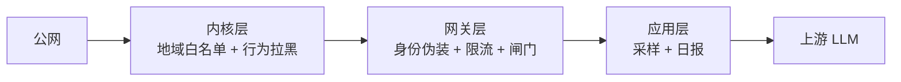

# 自用 LLM 网关的加固与观测：从威胁模型到日报
------
> 一台 2C2G 的小机器，把几个上游模型聚合成一个端点分发给朋友，一人一把 key。加固和观测做完，最值钱的不是某个开关，而是几条判断：暴露面按「身份」收敛，观测的第一条纪律是别把被观测的数据弄坏，验证尽量在零成本的路径上做。这篇只讲策略与取舍，不写具体地址、凭据、上游和产品细节。

## 先画威胁模型，再谈清单
------
> 抄别人的加固清单之前，先搞清楚谁在打你、想要什么。

一天 245 条被拦请求，画像很清楚：

| 维度 | 观测结果 | 策略含义 |
|---|---|---|
| 目标路径 | 四分之三打 `/v1/models` | 意图是找无鉴权的 OpenAI 兼容端点白嫖 token |
| 次要路径 | `/`、`/version`、`/connect`、管理面板路径 | 通用指纹探测，找的是「这是个什么服务」 |
| User-Agent | 全部为空 | 低成本脚本，连伪装都省 |
| 节奏 | 6 小时内 52 个 IP 各打 1 发 | 分布式单发，纯速率限制抓不住 |
| 收益 | 全部被无 key 404 拦掉，零上游成本 | 对方唯一的收获是知道了你是什么 |

三条推论决定了后面所有取舍：

- **扫描器的收益全在识别上。** 认出你是什么，它就已经完成要做的事。所以防线的目标是「不被标记」，而不只是「打不进来」。
- **分布式单发把防线从「速率」推向「计数」。** 单 IP 一分钟一发永远撞不到限流阈值，但六小时六发是稳定的行为特征，按行为计数才拦得住。
- **指纹比漏洞值得先花力气。** 路径、响应头、错误文案，这三样比任何 CVE 都更容易暴露软件性质。

同期还有 SSH 爆破（字典用户名、几分钟一发）。关掉密码认证、只留密钥之后它就是背景噪音，不值得为它再装组件。

## 分层：内核 / 网关 / 应用
------


| 层 | 拦什么 | 为什么放这一层 |
|---|---|---|
| 内核 | 地域白名单、行为拉黑 | 在 TCP 握手层就消失，不产生应用层日志、不消耗应用层资源 |
| 网关 | 身份伪装、限流、体积/并发/超时 | 懂协议，能做语义判断 |
| 应用 | 采样、拉黑决策、日报 | 唯一给人看的出口 |

分工的判据就一句：能在握手层挡掉的，别留到应用层；需要看懂请求语义的，内核层做不了。

## 身份隐藏：404 要与「路径不存在」逐字节一致
------
未认证的请求应该看起来像「这个路径不存在」：

| 情形 | 响应 |
|---|---|
| 无 key / 错 key | 404，body 与路径不存在完全一致 |
| 不打算支持的协议入口（比如别家的 messages 接口） | 专门加一条更具体的路由把它 404 掉 |
| `/v1/models` 带不带尾斜杠 | 都是 404 |

真正难缠的是响应头。限流器出于好意给所有响应打 `x-ratelimit-*`，等于在匿名 404 上写明「这里是带按 IP 限流的 API 网关」，还附送精确阈值——那是一个攻击节奏预言机。

- 404 和 200 上的这几个头能剥干净（响应策略与生成 404 的那条策略同链，走响应回程）。
- **429 剥不掉。** 限流器产生的 429 走错误响应路径，根本不进响应策略链。实测把它插进各个策略层级都不生效，某些层级还会被 schema 直接拒掉。

> 这里的决策是接受现状：地域白名单下能看见 429 指纹的只剩「国内来源且打爆限流的客户端」，而它吃完第一个 429 后一分钟内会被外部拉黑器掐掉；海外扫描器连 TCP 都握不上手。根治要重建网关二进制，收益不抵风险，暂缓。

投入产出比最高的一次审计是上线前 `curl -i` 把 404 / 200 / 429 的响应头全量过一遍。框架自带的头比路径和报错更容易暴露软件性质。

## 鉴权与归属：一人一把 key
------
- key 一人一把，key 的元数据里带用户名和分组，请求日志把它落成独立的用户列。查用量、判滥用、吊销都靠这一列。
- 吊销 = 删掉那一行并重启。**曾经发过的共享 key 要显式删除**，否则它的请求会变成 404，而使用者以为自己只是被限流。
- 无 key 与错 key 不做区分（都 404），这是有意的：区分等于告诉对方「这条路存在，只是你没带钥匙」。

## 限流的三个维度与三个坑
------
三个维度各管一件事：按来源 IP 防扫描、按 key 防单个朋友跑飞、按 token 量防成本失控。

坑一：**桶的键决定了谁受影响。** 按来源 IP 的桶对所有请求生效，包括带 key 的。想给未认证请求单独降配额，直接改全局桶会误伤 NAT 后面正常用 agent 客户端的朋友——60 次/分钟对他们很容易撞到。

坑二：**条件限流（按是否认证分叉）在配置层表达不出来。** 三个负结果实验：解析层直接拒绝启动；能启动但恒真条件也不执行；被更具体的策略整体覆盖（单槽位字段，更具体者胜）。最后用外部行为拉黑器做等价替代，效果一样，代价是多一个组件。

坑三：**策略执行顺序是固定的。** 限流先于匿名 404 的生成，于是语义被钉死：404 = 未认证且配额内，429 = 配额耗尽（带不带 key 都一样）。想让匿名 404 不带限流头，配置层做不到。

> 限流阈值是使用体验的取舍，不该由「顺手加固」顺手决定。给朋友用的服务，阈值松紧是产品问题。

## 数据面的闸门：体积、并发、超时、重试
------
| 闸门 | 策略 | 为什么这么定 |
|---|---|---|
| 请求体上限 | 16 MiB，fail-closed | 超限毫秒级 413，不是慢慢读完再拒——慢读本身就是资源占用 |
| 并发上限 | 全局一个数，超限直接 503，不排队 | 排队会把延迟堆到超时，直接拒更快 |
| 超时 | 全局放宽（长回答要活）+ 给已知不稳的上游单独压短 | 一个挂住的上游能拖到全局超时 |
| 重试 | 路由级，覆盖 408/429/5xx | 框架通常没有按模型配重试的开关，要拆路由 |
| 客户端 key 配额 | 按分钟请求数 + 按小时 token 量 | 两条独立口径，防跑飞和防成本 |

两个容易搞错的假设，都要用实验确认：

- **并发上限的作用域。** 它可能按监听端口各算一份。你以为是 64，实际两个端口合计 128。
- **超时对不稳上游的隔离。** 全局 900s 是给正常长回答的；某个上游正常 8~15 秒、超过 30 秒就是挂了，给它单独一条短超时，别让它占着全局额度。

## 降级链的三件套
------
首选上游打不通时切到兜底，这件事需要三处配合，缺一条就会漏：

```yaml
# 1. 健康判定：把配额耗尽也算不健康
health:
  unhealthy_when: '响应码 == 429 或 >= 500'   # 默认只算 5xx 与连接失败

# 2. 驱逐：一次失败即驱逐，带退避
eject:
  consecutive_failures: 1
  duration: 120s                            # 按次数倍退避：120s → 240s → 360s

# 3. 重试：让同一条客户端请求改投兜底
retry:
  attempts: 3
  backoff: 500ms
  codes: [408, 429, 500, 502, 503, 504]
```

第一条最容易漏。上游额度耗尽返回的是 **429**，而网关默认只把 5xx 和连接失败当不健康，于是「额度用完了」被当成「一切正常」，请求一直打在打不通的首选上。

第二条的机制要注意：**驱逐是异步的，触发驱逐的那条请求本身仍会失败。** 所以第三条的重试不是可选优化，而是链路的一部分。

实测（连打十次，首选是配额很紧的上游）：前两次走首选，第三次起日志出现兜底后端，客户端全程 200。把 429 从健康判定里临时去掉后，客户端立刻拿到上游的 429——这同时证明了优先级顺序确实生效。

## 进程沙箱：把安全分数当待办清单
------
服务用非 root 账号跑，unit 里把沙箱项补全：

```ini
[Service]
User=<专用账号>
UMask=0077
CapabilityBoundingSet=
AmbientCapabilities=
ProtectSystem=strict
PrivateTmp=true
PrivateDevices=true
ProtectClock=true
ProtectHostname=true
ProtectKernelLogs=true
ProtectProc=invisible
RestrictRealtime=true
SystemCallArchitectures=native
NoNewPrivileges=true
MemoryMax=800M
```

几个判断：

- **端口大于 1024 不需要任何 capability**，所以清空 `CapabilityBoundingSet` 是安全的。
- **`systemd-analyze security` 的分数可以当待办清单用**，实测从 5.9 MEDIUM 降到 3.2 OK。它扣分的地方就是还能收紧的地方。
- **`UMask` 只管新建文件。** 已经存在的用量库文件得单独 `chmod`，不然全机谁都能读全部用量——这条是部署期真实踩到的。
- **配置文件权限要按内容定。** 里面有客户端 key，就该是 0640 root:服务组，热加载不受影响。
- 分数不是目标。剩余扣分项里有一条是「用 `nobody` 这类共享账号」，扣得有道理，但建专用账号被 agent 的命令黑名单挡住了（`useradd` 在列），只能留到控制台手工做。

## 观测：三条信号各回答一个问题
------
| 信号 | 回答什么 | 注意 |
|---|---|---|
| 指标 | 线上进程现在在做什么 | **惰性指标首次触发才出现 series**，「查不到」会被误读成「没生效」 |
| 访问日志 | 单条请求的判定链：命中哪条策略、走了哪个后端、重试几次 | 排障主力 |
| 用量库 | 谁、用了什么模型、多少 token、多少钱 | 每请求一行，成本由目录价格算出 |

指标那一行值得单说。护栏、限流这类计数器通常是惰性创建的：改完配置去查指标是空的，这时候「空」既可能是没生效，也可能是没触发过。**主动打一条会命中的请求，再查。** 同理，证明「线上进程加载了这套规则」和证明「规则行为是对的」是两件不同的事，前者需要指标加访问日志，后者需要 mock 上游。

## 观测的纪律：读数据的手别把数据弄坏
------
这几条都是踩出来的，和配置无关，但比配置重要：

1. **读用量库必须先复制副本**（db + wal + shm 一起拷出来再打开）。直接用手上的 `sqlite3` 点原库，哪怕只是 `.tables`，都会在旁边留下一个属主不对的空文件，之后服务写库直接 `readonly database` 报错。这是部署期的真实事故。
2. **统计失败必须显式报错。** 曾经有个 SQL 异常被吞掉，日报里「被拦来源」整段静默消失，而报告看起来一切正常。观测系统静默失败比不观测更危险。
3. **时间列通常是 UTC 文本，比较前先做时区转换。** 直接拿文本和 `datetime()` 的结果比，会在第 11 个字符上退化成按日期比较，24 小时窗口悄悄变成 24~48 小时。
4. **带点的 JSON key 必须写成 `'$."a.b"'`。** 写成 `'$.a.b'` 会当成嵌套路径，静默返回 NULL——我第一遍统计出「公网流量 322 条」，其实全部落进了 ELSE 分支。
5. **库目录要给服务账号可写。** 沙箱下改 unit 必须 `daemon-reload` 再 restart，否则 `ReadWritePaths` 不生效，服务仍然报 `unable to open database file`。

## 观测的出口：每天一封日报
------
一台没人天天登的小机器，观测必须有「推」的出口，否则等于没有。做法是一个 Go 静态二进制 + 四个 timer：每 10 分钟资源采样、每分钟拉黑决策、每天刷新地域白名单、每天固定时刻发一封邮件。

日报的内容按「一眼能看出今天有没有异常」来排：

| 段落 | 内容 |
|---|---|
| 状态摘要 | 阈值超限项（决定标题里的 ⚠）+ 资源指标芯片（绿/橙/红） |
| 主机资源 | 24h 均值/峰值 + 当前快照 + 运行时长 |
| 网关用量 | 总数、公网真实流量、404/429/5xx、token、USD、按人×模型表 |
| 扫描内容分析 | 无 key 被拦请求的路径 Top + 意图归类 + 无 UA 占比 |
| 被拦来源 | 按 /24 聚合 + 次数 + 404/429 分布 + 归属地 |
| 调用成功来源 | 逐 IP 归属地 + token + 用户，新出现的 IP 打标记 |
| 当前封禁 | 封禁集合元素与剩余时长 |
| 报错 TopN | 系统与网关各取前几名 |

两条排版上的讲究：

- **报错 TopN 要取「出现次数最多的那条消息」，不能取第一条。** 取第一条会把偶发噪音（比如一次历史遗留的文件损坏）当成主因，掩盖真正的量级。
- **统计窗口一律近 24 小时。** 拉长会把旧流量混进当日视图，很容易误读成「今天被打了」。

> 邮件模板外置成文件、改完即时生效、写坏了自动回退内嵌兜底版本，这个设计省掉了「改一行文案要重新编译发版」的摩擦，很值。

## 请求侧脱敏：先定范围，再选实现
------
需求是「把配置里的几个 key 和 IP 脱敏，不传给上游」。第一版做成了**按形态匹配**：`sk-` 前缀、长度超过 48 的随机串、任意 IPv4/IPv6。代价立刻显现：

- 长 base64 块、长 ID、40 位以上的哈希、形如 `1.2.3.4` 的版本号全被误伤
- 讨论里出现的任何第三方 IP 都被改掉

改成**精确值**之后（本机两个地址 + 各把 key 的具体值 + 客户端 key 按前缀认）：

| | 形态匹配 | 精确值 |
|---|---|---|
| 覆盖新值 | 自动 | 要显式加一行 |
| 误伤 | 高 | 无 |
| 可审计 | 说不清到底拦了什么 | 配置里逐条可见 |

> 在 LLM prompt 这个场景里，「看起来像秘密的东西」大部分是正常内容：长哈希、长 base64、版本号、别人的 IP。误伤即事故，所以精确值的代价值得付。范围这句话要一开始就拆成「要拦哪几个具体的值」，别拆成「长得像 key 的东西」。

实现边界也都实测过，几条值得记：

- **默认作用域不含工具调用的参数。** 工具参数在协议里是整段 JSON 字符串，改写它有把 JSON 改坏的风险，所以设计上留白是对的。
- **自定义 pattern 的替换文本固定**，只有内置的实体规则才会替换成实体名。
- **只做请求侧。** 流式响应会被直接跳过（框架日志里明说），而朋友基本都开流式——想做响应侧脱敏得换方案。
- **正则引擎是 Rust regex**，没有环视和反向引用。好处是配置校验会真的编译 pattern，写错当场拒；`(?=x)`、`(a)\1`、`[z-a]` 全部报错，不会留到运行时。

### env 引用的好处与一个静默坑
------
key 用环境变量引用而不写死在配置里：`$VAR` 在 pattern 里会展开，而管理面接口只回变量名原文、不回展开后的值，所以不会因为这条护栏多一份落盘副本。`--validate-only` 要先把 env 文件 source 进来。

坑在于：**展开扫的是整份文件的原文，注释也算。** 任何 `$` 紧跟变量名的地方都会被当成环境变量引用去查，查不到就整份配置加载失败。踩的时候是把说明文字写进了注释。

```bash
# 干净实验：别在被污染的配置上试
cp /etc/<gw>/config.yaml /tmp/t.yaml
printf '# probe $NOPE_XYZ\n' >> /tmp/t.yaml
set -a; . /etc/<gw>/env; set +a
<gw-binary> -f /tmp/t.yaml --validate-only   # 报 NOPE_XYZ 就说明注释也被扫
```

更麻烦的是**失败是静默的**：服务不挂、旧配置继续跑、PID 不变，只有一行 reload 失败混在正常输出里。差点当成「已生效」收工。

> 所以改完配置必须去日志里确认「加载成功」那一行真的出现了。「服务活着」和「新配置生效」是两件事。

## 零计费验证的三件套
------
这台机器有条硬约束：验证不打真实模型调用。于是摸出一套可复用的三件套：

1. **配置校验**：证明这份配置能被这个二进制解析。
2. **派生配置 + 回环 mock 上游**（主力）：从线上配置**派生**（只改端口、上游地址、库路径），这样被测的就是线上那几条规则，而不是另抄一份。然后两种协议各发一条请求，看 mock 实收什么。
3. **指标 + 访问日志**：证明线上进程加载并执行了规则。

前两件不需要真实上游，第三件需要一条能走到上游的真实请求。两者缺一不可。

**断言要双向。** 一次塞 26 个值进去：12 个必须被打（各把 key 的真实值、客户端 key、本机地址带端口与不带端口），14 个必须活下来（外部 IP、内网 IP 带端口、IPv6、`999.1.1.1`、版本号、40 位哈希、随机长 base64url、`sk-` 形状但不是真 key 的串、时间串、C++ 命名空间）。只验「该打的打了」会漏掉误伤。

两次「以为零计费」的账：

| 次 | 探针设计的假设 | 实际结果 |
|---|---|---|
| 第一轮 | 以为非法 `max_tokens` 会被上游 400 拒掉 | 上游照收，两条探针花了 261 + 87 token |
| 收窄后 | 以为某模型只走一种协议，发另一种会被本地拒掉 | 它两种都声明了，两条探针各真调了一次上游 |

> 凡是能走到上游的探针都会真花钱。要零计费，只有 mock 上游和「本地必然被拒」两条路；而「本地必然被拒」这种假设，必须先用 mock 验一遍。我那次就是假设错了，白花 token，还差点把一个错误结论写进文档。

## 网络层：白名单与行为拉黑
------
**地域白名单**（选了白名单模式）：只放行本地区网段，扫描器在 TCP 握手层就消失，既不进应用日志也不消耗应用资源。代价是朋友挂海外 VPN 时进不来，用两条兜底补：自动学习「近 7 天有成功调用」的来源 IP，加手工例外清单。

实现上有三个坑：

- **官方委托数据里同一网段可能被多次分配**，不自动合并重叠区间会导致整表加载失败（`conflicting intervals`）。
- **源站对大陆限速很凶**，下载要尽力而为 + 本地缓存 + 下载失败绝不清规则（fail-safe）。
- **规则装好之后一定要核验集合元素数，并从真实客户端打一遍。** 曾经出现「规则装上了、网段没进集合」的情况，而我自己恰好因为白名单里的例外能访问，差点漏过。

**行为拉黑**（不看地理，只看行为）：

| 触发条件 | 说明 |
|---|---|
| 网关自身限流产生的 429 且无 key | 限流是网关的判断，可信 |
| 无 key 的 404 达 6 次 / 6 小时 | 分布式单发的等价拦截 |

两条保护：

- **近 7 天有 200 成功调用的 IP 永不封**，防 NAT 或 VPN 后面的正常用户被连坐。
- **上游返回的 429 永不触发封禁。** 那是上游配额问题，封客户端 IP 毫无意义。

封禁放在内核的独立表里，只丢业务端口、不影响 SSH；内核表重启会丢，拉黑器每分钟按回看窗自动补齐，不需要持久化。

> 拉黑器平时多半空转，这是预期。真实扫描器以分布式单发为主，出现突发扫描时它才会拉。

## 做不到的部分，以及等价替代
------
| 想要的 | 现状 | 替代 |
|---|---|---|
| 按模型的重试次数 | 只有路由级 | 拆路由 |
| 下游 mTLS | 前端 TLS 只暴露版本/套件，客户端证书只在控制面 | bearer key 是唯一的客户端身份 |
| 未认证请求单独降配额 | 条件限流表达不出来 | 外部行为拉黑（无 key 404 计数） |
| 429 不带限流头 | 走错误响应路径，剥不掉 | 地域白名单 + 行为拉黑缩短暴露窗口 |
| 按 key 的并发上限 | 只有全局并发上限 | 无，记一笔 |
| 按 key 的模型白名单与预算 | 框架支持，还没配 | 值得做，纯收紧 |

> 加固的产出不只是一堆开关，还有一张「做不到」的清单。这张清单决定哪一层需要外部组件来补：条件限流做不到，就有了外部的行为拉黑器；响应侧脱敏做不到，就知道流式场景得换方案。

## 收尾：十条可复用的判断
------
1. 先画威胁模型：扫描器的收益在识别你，所以目标是不被标记。
2. 响应头是最大的身份泄露点，上线先 `curl -i` 把 404 / 200 / 429 全量过一遍。
3. 分布式单发逼着防线从「速率」走向「计数」。
4. 限流阈值是产品取舍，别让「顺手加固」替你决定。
5. 敏感值优先用环境变量引用，顺手确认管理面不会吐明文。
6. 断言要双向：该打的一个不漏，不该打的一个不伤。
7. 被测配置从线上派生，手抄会漂移。
8. 「服务活着」和「新配置生效」是两件事，改完查日志。
9. 观测的第一条纪律是别把被观测的数据弄坏；统计失败必须显式报错，静默的观测等于没有观测。
10. 零计费验证只有 mock 上游和「本地必然被拒」两条路，后者也要先用 mock 验。
